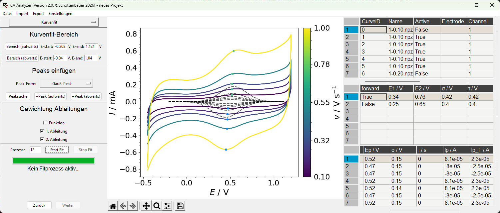

# CV-Analyzer

[](https://doi.org/10.5281/zenodo.24531543)

Desktop tool for evaluating cyclic voltammetry (CV) measurement series: import,
clean up, integrate, fit peaks, and export the results to Excel.

Built for electrode characterisation work (IrO₂ / RuO₂ pH sensors, sensor arrays),
but it is not tied to a specific electrode system.



Version 2.0 is the first public release; the 1.x series was developed privately.

## What it does

**Import** — PalmSens CSV and Excel exports, Raspberry Pi measurement ZIPs,
numpy `.npz`, and SRS files. A `.cvproj` project file stores curves together with
all settings, so a session can be resumed later. Project files written by older
versions can still be opened; files written by this version refer to the
`cv_analyzer` package, so reading them elsewhere requires it to be installed.

**Security note — project and settings files:** `.cvproj` and `.cvsettings` use
pickle-based joblib serialization. **A maliciously crafted file can execute code on
your computer when opened.** The loader checks what is inside before unpickling
(`cv_analyzer/projektdatei.py`): only the curve class and plain data pass, everything
else is refused with a message instead of being executed. That blocks the usual
pickle vectors, but a whitelist is a filter, not a sandbox — treat it as protection
against accidents, not as a security boundary. Only open files that you created
yourself or received from a source you fully trust. Downloading or cloning this
repository does not itself execute such files. The complete fix would be a
non-executable container format (JSON plus `.npz` arrays); it is not implemented in
this version.

**Prepare** — split a measurement into cycles, discard selected cycles, apply
Savitzky–Golay smoothing, reduce the number of data points per cycle by
interpolation, correct the potential axis against a reference electrode, and
normalise the potential axis (min/max or zero crossings).

**Integrate** — integrate a defined potential window of forward and reverse scan.
Charges, and the cumulative charge per curve, can be plotted and exported.

**Fit** — fit peaks to a chosen potential window. Peak shapes: Gaussian, Lorentz,
Voigt and exponentially modified Gaussian. Fitting uses particle swarm
optimisation (pygmo) on the signal together with its first and second derivative.
Every peak gets its position, height and width, plus the faradaic fraction of the
total current.

**Export** — peak-fit results, cumulative peak charge, faradaic-fraction results
and calibration peaks to Excel, including the curves as images.

## Installation

Requires Python ≥ 3.10, recommended 3.11 – 3.14.

**Linux**

```
sudo apt install python3-tk python3-venv     # Debian/Ubuntu
python3 -m venv .venv && source .venv/bin/activate
pip install -r requirements.txt
pip install -e .          # peak fitting (pygmo) comes along on Linux
cv-analyzer
```

**Windows**

pygmo has no pip packages for Windows, so the peak fitting is installed
through [conda-forge](https://conda-forge.org/download/). In the Miniforge
Prompt:

```
conda create -n cv python=3.12
conda activate cv
conda install -c conda-forge pygmo
pip install -r requirements.txt
pip install -e .
cv-analyzer
```

Step-by-step instructions, including the Tkinter packages for other
distributions and the common pitfalls, are in **[INSTALL.md](INSTALL.md)**.

### pygmo (peak fitting)

The peak fitting needs [pygmo](https://esa.github.io/pygmo2/). On Linux it
installs from PyPI:

```
pip install pygmo
```

On Windows and macOS there are no PyPI wheels, and the source distribution does
not build with pip. Use conda-forge there (e.g. with
[Miniforge](https://conda-forge.org/download/)):

```
conda install -c conda-forge pygmo
```

The analyzer starts without pygmo — only the peak fitting stays locked, and it
tells you what to install.

## Data formats

**PalmSens:** UTF-16 CSV export and XLSX, multiple channels supported.

**SRS:** single files or a folder for the Stanford Research Systems EC301
potentiostat (a reordering helper is included).

**Raspberry Pi setup:** measurement ZIP with raw files and metadata.

**numpy:** `.npz` files with pre-processed data.

The scan rate is read from the file name (`..._100mVps.txt` → 0.1 V/s). If the
name does not contain one, it is requested on import.

## Security

This is a local desktop tool. It opens no ports, contains no telemetry and no
update check, uses no network code at all (the only URLs in the source are
literature references in comments), and does not use `eval` or `exec`.

The one place where a file can do more than carry data is the **project file** —
see the [security note](#what-it-does) at the top. Excel output is plain `.xlsx`
without macros.

## Repository layout

```
cv_analyzer/
    __main__.py         entry point for python -m cv_analyzer
    main.py             GUI, data model, calculation pipeline
    FigureFrame.py      plot widget with interactive peak picking
    TableFrame.py       table widget for curves, peaks and results
    FileDialog.py       file dialogs (Tk, with zenity/kdialog fallback on Linux)
    IO_Functions.py     importers, cycle splitting
    mf1_... mf4_...     method panels (manipulation, plot, integration, fit)
    helpers.py          numerical helpers (peak shapes, regression, colours)
CV_Analyzer.py          launcher for running from the repository folder
pyproject.toml          package metadata
INSTALL.md              detailed setup instructions for Linux and Windows
THIRD_PARTY.md          licences of all runtime dependencies
Testdaten/              sample measurements to try the program with
docs/                   screenshot used by this README
```

`helpers.py` used to live in a separate private library; it was inlined so this
repository needs nothing beyond PyPI.

`Testdaten/` holds example measurements from the electrode characterisation
work this tool was written for: PalmSens CSV and XLSX exports, SRS text files,
`.npz` arrays and ZIP archives of the same, a few hundred kB to a few MB each.
They exist so the importers and the fitting can be tried without recording
anything first — pick one file from `Testdaten/palmsens-csv/` and go. The
folder is not needed to run the program and can be deleted.

## First steps

1. `Import` → choose your measurement files.
2. By default the field **"Zyklen verwerfen"** (cycles to discard) is set to `1`,
   because the first cycle usually differs from the rest. If your file contains
   only one cycle, the plot stays empty — clear that field and press
   **"Neu berechnen"** (recalculate).
3. The window needs roughly 1400 px width for the panels to sit next to each other.

## Limitations

- The user interface is in German.
- No automated test suite is included in this repository.
- Windows is the primary development platform; Linux works, macOS is untested.
- The window layout does not reflow well below roughly 1400 px width.
- The module names inside the package keep their historical spelling
  (`IO_Functions`, `mf1_Manipulation`, ...).

## AI assistance

The program itself is the author's work: architecture, GUI, importers,
numerical routines, peak fitting and the evaluation logic behind them were
written by hand. Generative AI support was used for the release work around it —
adapting the code to current Python and library versions (Python 3.12–3.14,
numpy 2, pandas 3, matplotlib ≥ 3.8), the packaging (`pyproject.toml`, entry
points, this README and `INSTALL.md`) and the preparation of the accompanying
data record. Every such change was reviewed and checked by running the program;
the numerical behaviour is unchanged, and no measurement data were generated or
altered.

## License

GNU General Public License v3.0 or later — see [LICENSE](LICENSE).

The GPL is required here because the table widgets are built with
[pandastable](https://github.com/dmnfarrell/pandastable), which is licensed
under GPL-3.0. Licence details for every dependency are listed in
[THIRD_PARTY.md](THIRD_PARTY.md).

## Citation

If this tool contributed to published work, please cite it as described in
[CITATION.cff](CITATION.cff). The archived release is
[doi:10.5281/zenodo.24531543](https://doi.org/10.5281/zenodo.24531543); the
concept DOI [10.5281/zenodo.24531542](https://doi.org/10.5281/zenodo.24531542)
always resolves to the latest version.
